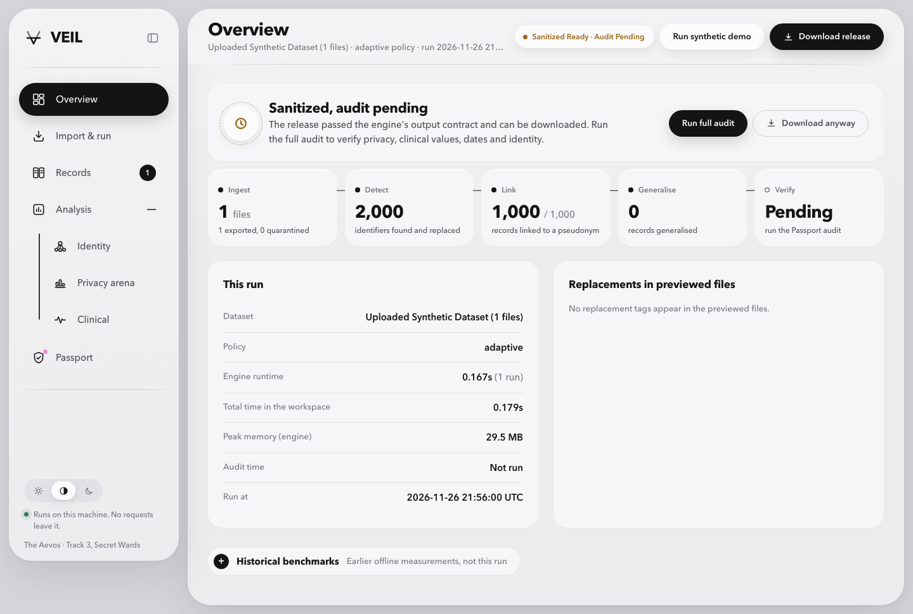
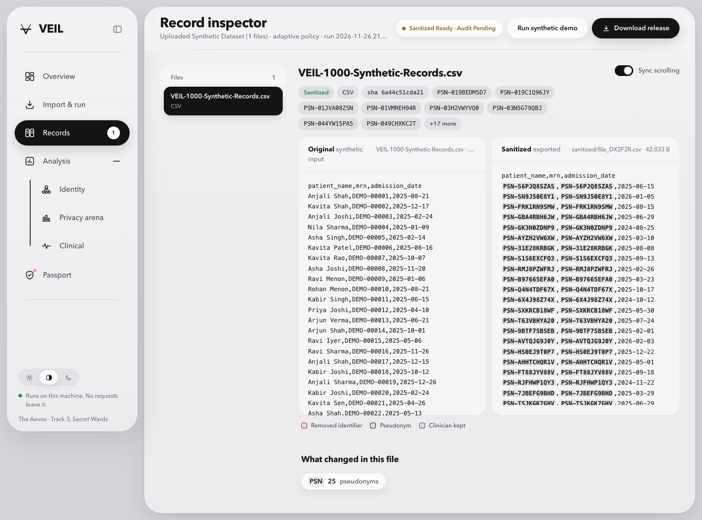
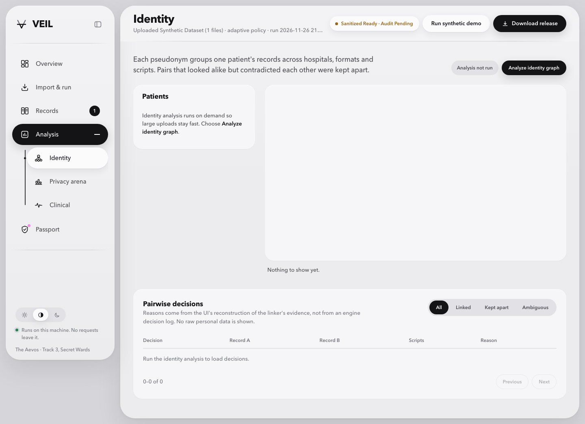
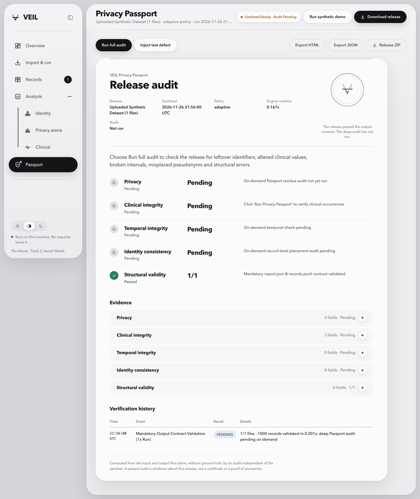
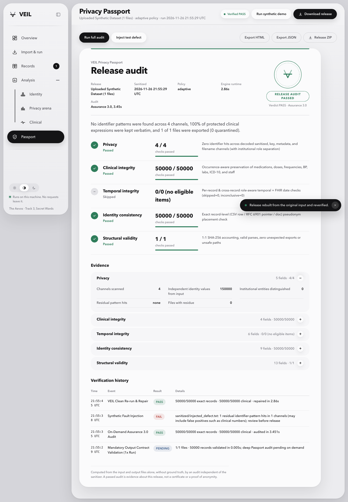

# VEIL — Verifiable Entity Integrity Layer

> **Hide the identity. Preserve the medicine.**

**Team The Aevos** (Leader: **Ishan Kumar** · Members: **Kirtan**, **Aryan Verma**, **Ukani Het**) · **Yugaantar DevForge — Track 3: Secret Wards** · **Repository:** https://github.com/ThatKJ/VEIL

**VEIL** (Python package `rakshak`) is an **offline, CPU-only, zero-dependency, LLM-free clinical privacy firewall and independent release verifier**. Designed for heterogeneous, multilingual Indian hospital exports (`CSV`, `TSV`, nested `JSON`, `JSONL`, `FHIR R4 Bundles`, `HL7 v2`, fixed-width reports, and mixed-script clinical notes), VEIL moves beyond brittle single-row PII masking: it **resolves patients across languages and hospitals without merging homonyms, measures and reduces longitudinal re-identification risk, preserves clinical truth and hospital-stay timelines verbatim, and proves every release through an independent five-pillar verifier and adversarial mutation harness.**

---

## Verified Highlights at a Glance

> **Scope note:** Practice-checker and validator rows use the unmodified official organizer toolkit. Attack arena percentages, synthetic suites, and scaling timings reflect our offline local evaluation harness on synthetic data—not official hidden leaderboard scores.

| Dimension | Verified Result (Current Freeze `submission-final`) | Evidence Scope |
|---|---|---|
| **Official Contract & Checker** | **`CONTRACT OK`** · **`READY TO SUBMIT`** | Fresh anonymous HTTPS clone · unmodified `check_submission.py --run` & `validate_output.py` |
| **Practice Dataset Accounting** | **`200` files** (`193` sanitized, `7` quarantined fail-closed) · **`817` records** · **`48` patients** | Official `dev` synthetic practice set |
| **Medical & Timeline Preservation** | **`98.1%` medical values kept (`4,763 / 4,855`)** · **`0/4` canary leaks** · `92` intentional district drops | Official `dev` (`check_dev.py`) · temporal interval/LOS score `0.98` |
| **Patient Identity Resolution** | **Precision `1.00` · Recall `≈ 0.98` · F0.5 `1.00` · `0` false merges** | Official `dev` (`check_dev.py`) · conservative abstention when ambiguous |
| **Practice Direct-ID & DOB Audit** | **`0/3,230`** (10/12 secrets & Linux) · **`2/3,230`** (2/12 secrets, coincidental shifted DOB overlaps) | Verified **`0`** unshifted original DOB cells (`60/60` multi-format DOBs shifted) |
| **Local Attacker (`ATTACKS.md`)** | **`47/48` raw** → **`43/48` direct masking** → **`10/48` VEIL adaptive** (**`78.7%`** vs raw, **`76.7%`** vs mask) | Local `dev` re-implementation of published attacker (`aegis-kA`; `9/48` with `grid`) |
| **Containerized Linux Parity** | **`exit 0` · `0.74–0.79s` · `~31 MB` RSS** (`dev`); **`87s` (2-CPU) vs `216s` (1-CPU) · `336 MB`** (`100k` rows) | Fresh clone in `python:3.12-slim` (`2 CPU`, `4 GB`, offline, read-only); byte-identical to macOS |
| **Full Regression & Mutation Gate** | **`73/73` unit + Chromium Playwright tests** (`0` skips/fails) · **`34/34` UI journeys @ `50k`** · **`16/16` mutations** | Latest verified release gate (`0` browser console/page errors) |
| **Runtime & Dependencies** | **Python `3.9+` stdlib only** · **`0` external packages · `0` model weights · `0` network calls** | Verified across `PYTHONHASHSEED`, Linux/macOS, and offline socket-blocked runs |

```bash
pip install -r requirements.txt                                   # no third-party runtime packages required
RAKSHA_SECRET="<secret>" python3 main.py --input <in_dir> --output <out_dir>
```

---

## Table of Contents

1. [The Problem VEIL Solves](#the-problem-veil-solves)
2. [What Makes VEIL Different](#what-makes-veil-different)
3. [System Architecture & Pipeline](#system-architecture--pipeline)
4. [Core Capabilities](#core-capabilities)
   - [Multilingual & Multi-Format PII Detection](#multilingual--multi-format-pii-detection)
   - [Cross-Script Patient Identity Firewall](#cross-script-patient-identity-firewall)
   - [Cryptographic Pseudonymization (`HMAC-SHA256`)](#cryptographic-pseudonymization-hmac-sha256)
   - [Adaptive Longitudinal Privacy & Clinical Utility](#adaptive-longitudinal-privacy--clinical-utility)
5. [Independent Verification: Privacy Passport & Mutation Lab](#independent-verification-privacy-passport--mutation-lab)
   - [Five Verification Pillars](#five-verification-pillars)
   - [Adversarial Mutation Lab (16/16 Defects Caught)](#adversarial-mutation-lab-1616-defects-caught)
6. [Security & Threat Model](#security--threat-model)
7. [Benchmarks, Scaling & Privacy–Utility Analysis](#benchmarks-scaling--privacyutility-analysis)
8. [Setup, Official CLI & Contract](#setup-official-cli--contract)
9. [VEIL Interactive Command Center (Dev/Demo UI)](#veil-interactive-command-center-devdemo-ui)
10. [Known Limitations & Honest Boundaries](#known-limitations--honest-boundaries)
11. [Repository Structure & Research Attribution](#repository-structure--research-attribution)
12. [Team & Licence](#team--licence)

---

## The Problem VEIL Solves

Clinical research datasets aggregated across hospitals cannot be made safe with regex-based single-row scrubbing:

1. **Multilingual & Encoded Fragmentation:** The same patient appears as `"Mohammad Arif"` in an English registration CSV, `"मोहम्मद आरिफ"` in a Devanagari discharge note, `"Md. Arif"` in a Hinglish OPD JSON object, and base64/hex/URL-encoded substrings inside malformed attachments, legacy codepages (`UTF-16`, `cp1252`, mojibake), JSON keys, CSV headers, and filenames.
2. **Clinical Context Ambiguity:** Naive scrubbers either leak relatives (`C/O Ramesh`, `S/O Mohan`) or destroy medicine (`C/O fever`, `S/O consolidation`, `Dr. Ramesh`, `ASHA worker` vs patient `Asha Devi`, `Parkinson's disease`, `Tab. Metformin 500 mg BD`, `1-0-1`, `Platelets 70000-90000 /cumm`).
3. **False Merges Corrupt Clinical Truth:** Naively linking records with similar names merges distinct homonymous patients (`Ramesh Kumar` in Ward 1 vs `Ramesh Kumar` in Ward 4), fabricating medical histories and leaking shared family demographics.
4. **Longitudinal Quasi-Identifier Re-Identification:** Even with direct IDs stripped, pooling *(age, gender, district/village/PIN, admission date, rare ICD-10 diagnosis, and exact length of stay)* against a population registry or known-visit facts singles out rare patients—while naive global date shifts fail the moment two patients expose a shared offset.

---

## What Makes VEIL Different

VEIL treats clinical de-identification as an **end-to-end verifiable systems problem** rather than a flat NER script:

1. **Discovers PII across channels:** Structured columns, arbitrary nested JSON/FHIR paths, HL7 v2 segments, stacked/EAV/pipe-packed CSV tables, free-text notes, filenames, CSV headers, JSON keys, and decoded Base64/Hex/Unicode-escape/URL payloads.
2. **Resolves fragmented identities across scripts:** Translates 9 Indic scripts (`\u0900–\u0D7F`) + 9 numeral systems + Latin into script-independent phonetic skeletons and links via strong IDs and multi-attribute blocking.
3. **Prevents unsafe merges:** Applies whole-cluster contradiction invariants (`gender`, compatible birth years, conflicting Aadhaar/ABHA/PANs, conflicting surname/relative stems, family-card exclusions) and abstains when evidence is insufficient.
4. **Issues purpose-separated `HMAC-SHA256` pseudonyms:** Generates 50-bit Crockford Base32 tokens (`PSN-XXXXXXXXXX`) with deterministic order-independent collision resolution.
5. **Measures longitudinal quasi-identifier exposure:** Pools every resolved patient's attributes across files before choosing privacy actions.
6. **Adapts generalization by risk:** Applies minimal-loss ARX lattice generalization—preserving 5-year bands and clinical utility for common profiles while escalating rare profiles, rare diagnoses (`<= 3` patients), and seniors (`>= 80`) to 10-year bands and geography suppression, with secret per-patient date shifts (`±180` days).
7. **Preserves clinical signal intact:** Protects dosages, frequencies, vitals, lab units, medical eponyms, clinicians (`Dr.`, `Sr.`, `SN`), ICD-10 distributions, and exact admission-to-discharge stay durations (`LOS`).
8. **Independently verifies every release:** Audits the anonymized outputs blindly with zero ground truth via a five-pillar **Privacy Passport** (Privacy, Clinical, Temporal, Identity, Structural).
9. **Validates its own verifier continuously:** Exercises **16 controlled defect mutations**—including row/column-aligned unshifted original birth dates—confirming that corrupted outputs fail verification rather than silently passing.

> **Core narrative:** VEIL does not merely sanitize hospital records. It provides **measurable evidence** of what was protected, what was preserved, and what was verified.

---

## System Architecture & Pipeline

The runtime engine (`main.py` + `rakshak/`) executes in two deterministic passes with strict RAM-vs-disk isolation (`tools/` and `web/` are offline dev/demo assurance utilities and are never imported by `main.py`).

```mermaid
flowchart LR
    IN["Heterogeneous Hospital Exports<br/>(CSV, TSV, JSON, JSONL, FHIR R4, HL7, TXT)"] --> ING["1. Safe Ingestion & Normalization<br/>(UTF-8/16/cp1252, CleverCSV, Symlink/Binary/&gt;64-JSON Quarantine)"]
    ING --> DET["2. Multilingual PII & Clinical Guards<br/>(EN/HI/Hinglish/Indic, Eponyms, Dr./SN, Base64/Hex/URL)"]
    DET --> FW["3. Identity Firewall (RAM Only)<br/>(Phonetic Skeleton, Inverted Blocking, Cluster Vetoes)"]
    FW --> PSN["4. Keyed Cryptography<br/>(HMAC-SHA256 → 50b Crockford PSN + ±180d Shift)"]
    PSN --> ARX["5. Adaptive Longitudinal Privacy<br/>(Pooled k5/k10 ARX Lattice, Rare-ICD/Elder Escalation)"]
    ARX --> EXP["6. Atomic Release Export<br/>(UTF-8 sanitized/ + report.json + records.jsonl · PII-free logs)"]
    EXP -.->|"Independent Zero-Truth Audit"| PP["7. Privacy Passport (5 Pillars)<br/>(Privacy · Clinical · Temporal · Identity · Structural)"]
    PP -.->|"16/16 Synthetic Defects Caught"| LAB["Adversarial Mutation Lab"]
```



### Security & Processing Boundaries

| Stage | Where Data Lives | Boundary Enforced |
|---|---|---|
| **Runtime CLI (`main.py`)** | Parsed records, identity graph, and `RAKSHA_SECRET` HMAC state stay strictly in **process RAM** (freed before export) | Zero scratch files written to `TMPDIR` or `HOME`; input directory read-only and verified unchanged; `stdout` emits counts only |
| **Unsafe / Corrupt Files** | Quarantined in-memory (logged by SHA-256 + `reason` in `report.json`) | Symlinks leaving `--input`, binaries (`>2%` control/NUL), corrupt UTF-8, empty/unparseable payloads, and JSON nesting `>64` are **never copied raw into `sanitized/`** |
| **Atomic Export (`{output}`)** | Only finalized UTF-8 `sanitized/`, `records.jsonl`, and `report.json` via temp-file `os.replace` (`.veil_tmp_*` unlinked on error or child completion) | Path resolution enforces `.resolve().is_relative_to(san_root)`; filenames carrying PII are opaquely hashed while relative folders stay aligned |
| **On-Demand Assurance (`tools/`)** | `veil_passport.py`, `aegis_mutations.py`, and `veil_ui.py` inspect input/output pairs for developer assurance & live demonstration | Zero ground-truth dependency; never imported or invoked during official headless evaluation (`main.py`) |

---

## Core Capabilities

### Multilingual & Multi-Format PII Detection

- **Format-Agnostic Structural Parsing:** Handles quoted/unquoted multi-dialect CSV/TSV (CleverCSV-inspired consistency scoring), 2-row super-header tables, EAV (`attribute, value`) sheets, pipe-packed single-line key-values, nested/stringified JSON, JSON Lines, coded `column_codes` schemas, FHIR R4 `Bundle`s (with subject reference routing per patient), HL7 v2 segments (`PID`/`NK1`/`PV1`/`MSH`), `-----BEGIN STRUCTURED-----` hybrid notes, and multi-line clinical prose.
- **Script & Encoding Coverage:** Normalizes `NFKC`, Cyrillic/Greek visual homoglyphs, zero-width codepoints, Latin diacritics, `9` Indic scripts (`\u0900–\u0D7F`: Devanagari, Bengali/Assamese `ৰ`/`ৱ`, Gurmukhi, Gujarati, Odia, Tamil, Telugu, Kannada, Malayalam) plus Latin (`10` scripts total), `9` Indic numeral systems, and decodes Base64, Hex, `\uXXXX`, HTML entities, and percent-encoded payloads across content, headers, JSON keys, metadata, and filenames.
- **Clinical Meaning Traps:** Disambiguates clinician/nursing roles (`Dr.`, `Sr.`, `Sis.`, `SN`, `ANM`, `GNM`, `DEO`), eponyms (`Addison's disease`, `Parkinson's`, `McBurney sign`), `ASHA` health workers vs patients named Asha, clinical complaints (`C/O fever`, `W/O crepitations`, `S/O consolidation`) vs kinship fields (`W/O`, `S/O`, `D/O`, `sambandhi`), platelet/electrolyte ranges (`70000-90000 /cumm`, `mEq/1000mL`), and banded ages (`50-54 yrs`).

### Cross-Script Patient Identity Firewall

- **Blocking & Matching (`O(N)`):** Indexes strong normalized IDs (MRN/UHID, Aadhaar, ABHA, PAN), mobile numbers (`[6-9]\d{9}`, including `0091-` prefixes while stripping shared household STD landlines from cross-patient linking), phonetic skeletons across 10 scripts, and bounded secondary blocks (DOB, village, relative head token with bounded bucket caps).
- **Whole-Cluster Cannot-Link Constraints:** Prevents transitive snowball merges when merged sub-clusters conflict on gender, birth-year tolerance (`>8` yr DOB/byear delta or `>7` yr span), Aadhaar/ABHA/PAN IDs, conflicting surname/relative stems, or shared household ration/family card IDs (`Ration`, `KASP`, `Chirayu`, `PPP`, masked without linking family members together).
- **Conservative Abstention:** Singletons or ambiguous records without reliable linkable evidence receive distinct cluster handling or `"patient": null` in `records.jsonl` rather than risking a false merge.

### Cryptographic Pseudonymization (`HMAC-SHA256`)

- **Keyed 50-bit Crockford Base32 IDs:** `PSN-` + 10 characters derived from `HMAC-SHA256(RAKSHA_SECRET, "psn|" + canonical_key)`.
- **Purpose Separation:** Separate fixed-prefix HMAC tags (`"psn|"`, `"shift|"`, opaque key/file labels) prevent cross-domain key reuse.
- **Order-Independent Collision Handling:** Canonical sorted key ordering + indexed deterministic rehash prevents collision drift regardless of file arrival order (`0` collisions observed up to `1,000,000` unique patients in synthetic stress runs).
- **Strict Fail-Closed Key Policy:** `main.py` exits with code `2` if `RAKSHA_SECRET` is unset or whitespace. Changing `RAKSHA_SECRET` changes all pseudonyms and encounter date shifts (`A7` cross-release risk `0.0`).

### Adaptive Longitudinal Privacy & Clinical Utility

Governed by [`config/policy.yaml`](config/policy.yaml):

| Rule / Parameter | Default Behavior | Privacy & Utility Purpose |
|---|---|---|
| **Pooled Evaluation (`qi_mode: adaptive`)** | Aggregates `(district, gender, age_band, rare_icd)` per **resolved patient** before choosing transformations | Defeats cross-document profile correlation (`A4`) that single-row masking misses |
| **ARX Minimal-Loss Lattice (`arx_k5_dist_drop: on`)** | Tests `k(district, gender, band5) >= 5`; if sparse, checks `(None, gender, band5)` (`k_dist`) before widening to `10`-year bands | Preserves 5-year age resolution wherever possible while suppressing rare localizing geography |
| **High-Risk Escalation (`rare <= 3`, `age >= 80`)** | Forces `10`-year consistent age band and drops fine geography (`village`, `district`, `pin_mode: drop`) | Protects rare-condition and extreme-elder outliers without over-redacting typical cohorts |
| **Truthful Consistent Bands (`consistent_bands: on`)** | Every age token for a patient uses the exact same lattice interval containing true age | Eliminates multi-record intersection narrowing while keeping age bands 100% truthful |
| **Keyed Timeline Shifting (`date_shift_max_days: 180`)** | Every encounter date, `lastUpdated`, and birth date of a patient shifts by the same HMAC day offset (`!= 0`) | Preserves exact intra-patient intervals, length of stay (`LOS`), and valid FHIR `birthDate` syntax |

---

## Independent Verification: Privacy Passport & Mutation Lab

### Five Verification Pillars

`tools/veil_passport.py` evaluates any `(input_dir, output_dir)` release pair independently—using its own regex/unicode/grammar detectors without importing `rakshak/` internals and with **zero ground truth**. Every check explicitly separates:

- **`PASS`** — Verification succeeded across all evaluated items with zero defects.
- **`FAIL`** — Direct PII/residue leaked, clinical loss, timeline drift, missing/mismatched pseudonym placement, broken FHIR reference, malformed parse, or unshifted DOB detected.
- **`WARNING`** — Partially inconclusive items (e.g., inconclusive date deltas) or non-zero-probe edge warnings without clear leaks.
- **`SKIPPED`** — Category had zero applicable probes in the input/output pair.
- **`INCONCLUSIVE`** — Ambiguous format parsing or unresolved comparison boundaries.

| Pillar | What `veil_passport.py` Verifies | Latest `dev` Practice Result |
|---|---|---|
| **1. Privacy Residue** | Scans `sanitized/`, `report.json`, `records.jsonl`, headers, JSON keys, filenames, and decoded Base64 (min 12 data chars), Hex, `\uXXXX`, and URL escapes; applies Crockford assigned-PSN token boundaries (eliminating false PAN hits while catching adjacent/unassigned PANs), clinician/dose/Indic-institution context discrimination, and **row/column-aligned unshifted DOB detection** | **`PASS` (`0` genuine leaks; `0` unshifted DOB cells)** |
| **2. Clinical Integrity** | Occurrence-aware matching of medications, doses, frequencies (`1-0-1`), blood pressure, lab units, ICD-10 codes, and clinician/staff titles (`Dr.`, `Sr.`, `Sis.`, `SN`) | **`PASS` (`2,361 / 2,361` sampled occurrences, `100.0%`)** |
| **3. Temporal Integrity** | Per-file DMY/MDY inference, record-level and cross-record per-patient relative day deltas across CSV/JSON/notes/FHIR bundles, and valid FHIR date syntax | **`PASS` (`724 / 724` checks)** |
| **4. Identity Consistency** | Verifies every `records.jsonl` entry resolves safely inside `output/`, matches its exact CSV row, RFC 6901 JSON pointer, or text document, and confirms the claimed `PSN-...` token appears inside the exported record | **`PASS` (`774 / 774` placements verified)** |
| **5. Structural Validity** | 1:1 physical SHA-256 file accounting (`declared == exported + quarantined`), CSV row-count preservation, valid JSON/JSONL/TSV parsing, and FHIR R4 reference resolution (including `#id` contained resources) | **`PASS` (`200 / 200` files, `0` parse failures)** |

> **Scope clarification:** A clean Privacy Passport provides verifiable, audit-logged evidence for a specific release pair; it is **not** a formal certificate of anonymity under unseen external adversaries.

### Adversarial Mutation Lab (16/16 Defects Caught)

[`tools/aegis_mutations.py`](tools/aegis_mutations.py) and [`tools/mutation_lab.py`](tools/mutation_lab.py) clone a clean release into 16 isolated fault-injected directories—leaving the clean release untouched—to prove that the verifier fails closed on real defects:

| Mutation Category | Injected Synthetic Defects Tested (16 Total) | Expected Catching Pillar(s) |
|---|---|---|
| **Identifier Leaks (4)** | Plaintext PAN (`ABCPD1234F`), unmasked mobile (`9876501234`), raw synthetic patient name, Base64-encoded mobile (`14`-char token) | `privacy` |
| **Unshifted DOB Cell (1)** | Original input birth date restored verbatim into matching sanitized row/column DOB cell (tested independently across 5 formats & 5 header aliases, plus 60/60 engine DOB shifts verified) | `privacy` |
| **Clinical & Temporal Defects (3)** | Altered medicine dose (`+50 mg`), mutated laboratory value, altered admission/discharge date shifting `LOS` by 2 days | `clinical`, `temporal` |
| **Identity & Structural Integrity (8)** | Swapped pseudonym (`wrong_psn`), corrupted row locator (`row:99999`), dropped record, duplicated record, dangling FHIR reference (`urn:uuid:...`), unexpected extra output file, tampered `report.json` record count, truncated malformed JSON | `identity`, `structural` |

- **Measured Gate:** **`16 / 16` injected mutations detected** (`verdict != PASS`), while **8 clean releases** (including secrets generating coincidental cross-patient shifted date strings) and **60 independently formatted synthetic DOBs** passed with **0 DOB false alarms**. Detection of these 16 synthetic mutations demonstrates bounded defect-catching behavior on the tested harness and does not guarantee detection of arbitrary unforeseen corruption classes.

---

## Security & Threat Model

VEIL distinguishes strictly between the **headless competition CLI** (`main.py`) and the **local interactive demo server** (`tools/veil_ui.py`):

| Control Area | Official CLI (`main.py` + `rakshak/`) | Interactive Command Center (`tools/veil_ui.py`, Dev/Demo Only) |
|---|---|---|
| **Secrets & Keying** | Reads `RAKSHA_SECRET` solely from environment (`exit 2` if missing/blank); `HMAC-SHA256` with domain-separated tags and deterministic collision suffixing; never written anywhere | Public demo bundle uses a reproducible demo key; ordinary uploads without a user-entered secret receive an ephemeral `secrets.token_urlsafe(32)` random key (never logged or returned in API/ZIP) |
| **Process & Network Hardening** | 100% offline CPU execution; zero network imports; verified `exit 0` under socket-blocking harnesses and offline Docker containers | Loopback `_check_host` allowlist + exact port check (DNS-rebinding defense); strict same-origin `POST` check; `Content-Security-Policy` (`default-src 'self'`, hashed inline bootstrap script only, zero `'unsafe-eval'`), `X-Frame-Options: DENY`, `Referrer-Policy: no-referrer`, `Cross-Origin-Resource-Policy` |
| **Path & Parser Safety** | Symlink escape quarantine; `.resolve().is_relative_to(san_root)` output containment; `MAX_JSON_DEPTH = 64` + `RecursionError` quarantine | POSIX normalized relative paths (`400` on traversal/backslash/NUL); strict `64`-file / `16 MB` upload limits; RFC-2046 multipart parser resilient to mid-body `--boundary`; chunked/413 stream handling; streamed ZIPs (`SpooledTemporaryFile`) |
| **Cleanup & Fault Isolation** | Raw inputs & identity graph remain in RAM only (`gc.collect()` before export); temp `.veil_tmp_*` files unlinked; `stdout` contains only counts (`files X sanitized Y quarantined Z records W`) | Per-run `0700` workdir cleaned on Ctrl-C, `SIGTERM`, and `SIGHUP`; startup reaping via PID owner markers removes only dead same-user `veil_ui_*` dirs; atomic swap repair & `busy_run_dirs` reader locking |

> **Important Security Boundaries (Honest Disclosure):**
> * **`HMAC-SHA256` is pseudonymization, not encryption at rest.** Given a compromised or guessed `RAKSHA_SECRET`, pseudonyms are brute-forceable from candidate IDs.
> * **Pseudonymization is not formal anonymization.** Longitudinal clinical truths (`ICD-10` + `LOS`) carry residual re-identification risk on small cohorts.
> * **Deleting temporary files is not secure erasure, and RAM-only execution does not protect against a compromised host process, swap, or kernel crash dumps.** Production deployments on real patient data must run inside host OS/volume full-disk encryption (e.g., `dm-crypt`/LUKS, KMS-backed storage) with vault-managed `RAKSHA_SECRET`.
> * **`tools/veil_ui.py` is strictly for synthetic demonstration data**—never upload real Protected Health Information to the local UI.

---

## Benchmarks, Scaling & Privacy–Utility Analysis

### 1. Latest Verified Evaluation (`submission-final` / Engine `known-good-16` ≡ `known-good-15`)

#### A. Official Toolkit (`check_submission.py --run`, `validate_output.py`, `check_dev.py`)
- **`check_submission.py --run` (fresh anonymous HTTPS clone of `https://github.com/ThatKJ/VEIL`):** Exit `0` in `0.6s` → **`CONTRACT OK`** · **`READY TO SUBMIT`**. Same secret produces byte-identical `sanitized/` & `records.jsonl`; different secret rotates pseudonyms & shifts; `RAKSHA_SECRET` absent everywhere; `--input` untouched.
- **Official Practice Dataset (`dev`, `200` input files = `193` sanitized + `7` quarantined fail-closed, `817` records, `48` patients):**
  - `check_dev.py`: **`0/3,230` leaked** across `10/12` random secrets and Linux (`2/3,230` coincidental shifted-DOB string overlap on `2/12` secrets — `0` unshifted original DOB cells anywhere), **`0/4` canaries**, **`4,763 / 4,855` (`98.1%`) medical kept** (all `92` missing items are intentional `district` suppressions under `arx_k5_dist_drop`), linking **Precision `1.00`, Recall `≈ 0.98`, F0.5 `1.00`, `0` false merges, `0` raw copies**.
- **Final Regression Gate:** **`73/73` `unittest`** checks passing in `55.20s` (zero errors/skips, incl. headless Chromium Playwright across all 7 UI tabs with `0` console/page errors), **`34/34` UI browser journeys at `50,000` records**, and **`16/16` adversarial mutations detected**.

#### B. Local Attack Arena (`dev`, 48 Patients, Re-implemented `ATTACKS.md` Evaluator)
*(Local evaluation harness only—NOT the hidden official evaluation score.)*

| Configuration (`aegis-kA`, `48` dev patients) | Patients Re-Identified (`A4`) | Normalized `A4` (`÷ raw`) | Relative Reduction vs Raw | Temporal Utility | Local Est. Summary |
|---|---:|---:|---:|---:|---|
| Raw unsanitized input | `47 / 48` (`97.9%`) | `1.000` | — | `1.00` | Baseline |
| Direct masking only (`qi_mode: mask`) | `43 / 48` (`89.6%`) | `0.915` | `-8.5%` | `0.98` | Rejected (`A4` 4.3× worse) |
| **VEIL Adaptive Default (`arx_k5_dist_drop`)** | **`10 / 48`** (`20.8%`; `9/48` on `grid`) | **`0.213`** | **`78.7%` vs raw (`76.7%` vs mask)** | **`0.98`** | **Selected optimum** |
| Escalated DOB year-suppression variant | `3 / 48` | — | — | **`0.68`** | Rejected (breaks intervals) |

- **Why Aggressive Elder DOB Suppression Was Rejected:** Suppressing birth dates cleanly cuts local profile re-identification (`3/48`), **but drops temporal utility from `0.98` to `0.68`** and lowered estimated total scores on all three tested development/diagnostic suites (`dev`, `chaos_dev`, `H15`). Retaining per-patient shifted DOBs preserves cohort/pediatric-to-adult continuity alongside exact `LOS` and ICD-10 clinical signal.

#### C. Constrained Containerized Linux Execution (`python:3.12-slim`)
Verified on a fresh public clone (`c191fb1`, whose core sanitizer `main.py`, `rakshak/`, `config/`, `raksha.toml`, `requirements.txt` is **byte-identical** to `submission-final` / `known-good-16`) inside Docker (`aarch64`, `--network none --cpus 2 --memory 4g --memory-swap 4g --read-only`, tmpfs `/tmp`, `900s` limit):

| Linux Container Workload | Wall Time | Peak Process-Tree RSS | Correctness & Parity |
|---|---:|---:|---|
| **Official `dev` (`200` files, `817` records)** | **`0.74–0.79s`** | **`30.7–30.9 MB` (~31 MB)** | `exit 0` · `CONTRACT OK` · `0/3,230` (`check_dev`) · **byte-identical to macOS** |
| **`100,000`-row synthetic CSVs (`20` files, `10.8 MB`, `1` CPU)** | **`215.67s` (~216s)** | `335.8 MB` | `100,000 / 100,000` records exported |
| **`100,000`-row synthetic CSVs (`20` files, `10.8 MB`, `2` CPUs)** | **`86.97s` (~87s)** | **`336.0 MB`** | **`2.48x` speedup** · **byte-identical to single-process** |

> *Condition note:* The container run approximates organizer CPU/RAM/network/read-only budgets (`4 GB` / `2 CPUs` / `900s`) but does not replicate the organizer's exact seccomp profile, host kernel, or Python patch version.

### 2. Historical Scalability & Dashboard Timings (Labeled by Scope)

- **Historical Extreme-Scale Benchmarks (macOS Python 3.14, `tools/scale_titan.py`, pre-freeze APEX/OMEGA engine baseline—architecture unchanged in final core):**
  - **`1,000,000` unique patients (`1M_unique` CSV, `1,000,000` distinct `PSN-` pseudonyms, `0` collisions):** **`56.44s`**, **`2,481.1 MB`** peak RSS (`~17,718` rows/s, `< 4 GB` / `< 900s`).
  - **`1,250,000` nominal mixed lines (`1.25M_mixed_250kp`, `6,252` files across CSV/JSONL/TXT notes):** **`90.37s`**, **`1,623.8 MB`** peak RSS across **`943,750` actual physical VEIL records** (all `6,250` 50-line `.txt` notes map `1` document record each → `0` physical record loss).
- **Historical Passport Audit Optimization (`87aba54` vs `365dfd8`, `10,000` unique-patient CSV):** Improved audit runtime by **`~21.6x`** (`13.99s` pre-fix → `0.61s–0.65s` with O(N+L) `_GramIndex` and Crockford PAN boundary filtering, fixing 18 false PAN detections inside valid pseudonyms).
- **Latest Dashboard Sanitized-Ready Latency (`b922dd8` test suite, `1x` engine run + validation before optional user-triggered Passport/Arena/Graph clicks):**
  - `100` unique rows: **`0.159s`** · `1,000` unique rows: **`0.157s`** · `5,000` unique rows: **`0.312s`** · `10,000` unique rows: **`0.627s`** · `25,000` repeated-patient rows: **`0.969s`** · `50,000` repeated-patient rows: **`2.019s`** (`state.active` payload bounded to `7.0–7.1 KB`).

---

## Setup, Official CLI & Contract

### Installation
```bash
git clone https://github.com/ThatKJ/VEIL.git
cd VEIL
pip install -r requirements.txt          # Python 3.9+ standard library only (no downloads)
```

### Official Evaluator Command
```bash
RAKSHA_SECRET="<secret-per-release-key>" python3 main.py --input /path/to/input --output /path/to/output
```

### Input & Output Contract (`SPEC.md`)

- **Accepted Inputs:** Directory tree of `.csv`, `.tsv`, `.json` (nested dicts, object arrays, FHIR R4 `Bundle`s), `.jsonl`/`.ndjson`, `.txt`, `.hl7`, UTF-8/BOM/UTF-16/`cp1252` encodings, and malformed/unsupported inputs (quarantined safely).
- **Output Layout (`{output}/`):**
  ```
  output/
  ├── sanitized/        # Mirrors --input directory tree in UTF-8; PII filenames hashed opaquely
  ├── report.json       # schema: "raksha-report/1", SHA-256 per physical input, counts, timing, RSS
  └── records.jsonl     # {"file", "loc" ("row:N" | RFC 6901 pointer | "doc"), "patient" ("PSN-..." | null), ...}
  ```

---

## VEIL Interactive Command Center (Dev/Demo UI)

VEIL ships an offline, framework-free local inspection and demonstration workbench (`tools/veil_ui.py` + `web/`) backed by `demo/sample_hospital/`—built strictly for **synthetic demonstration datasets**:

```bash
./launch_veil.sh                         # equivalent to: python3 tools/veil_ui.py --demo --open
```

Navigate to `http://127.0.0.1:8765/`. The interface separates fast `1x` sanitization (`Upload & Run`, up to 64 files / 16 MB) from on-demand analytics (**Overview**, **Record Inspector**, **Identity Graph**, **Privacy Arena**, **Clinical Integrity**, and **Privacy Passport** with interactive defect injection and atomic repair).

| Overview Workspace | Record Diff Inspector |
|---|---|
|  |  |

| Cross-Hospital Identity Graph | 5-Pillar Privacy Passport | Post-Repair Clean Assurance |
|---|---|---|
|  |  |  |

*(Additional high-contrast dark, mobile `390px`, tablet `768px`, rail-mode, empty-state, and error-state views are tracked under [`docs/frontend/screenshots/after/`](docs/frontend/screenshots/after/).)*

---

## Testing, Reproducibility & Compliance

```bash
# 1. Full 73-test suite (core hardening, security/CSRF/CSP, DOB cells, Passport, Playwright Chromium)
PYTHONDONTWRITEBYTECODE=1 python3 -m unittest discover -s tests -q

# 2. UI 50k end-to-end journey suite (Playwright, 34 checks across viewports & defect->repair)
python3 web/tests/journeys.py --rows 50000

# 3. Standalone Privacy Passport audit & 16-defect Mutation Harness on any synthetic release
python3 tools/veil_passport.py --input demo/sample_hospital --output /tmp/veil_demo_out \
  --html /tmp/passport.html --json /tmp/passport.json
python3 tools/aegis_mutations.py --input demo/sample_hospital --release /tmp/veil_demo_out --work /tmp/veil_muts

# 4. Official toolkit verification (run against Secret-Wards-ToolKit)
python3 /path/to/Secret-Wards-ToolKit/validate_output.py --input dev/input --output /tmp/veil_dev_out
python3 /path/to/Secret-Wards-ToolKit/check_submission.py --repo . --run
```

### Official Competition Checklist
- Public GitHub repository created during hackathon (`https://github.com/ThatKJ/VEIL`) with root [`raksha.toml`](raksha.toml) naming team **The Aevos**.
- Offline, CPU-only, Python `3.9+` standard-library runtime (`requirements.txt` contains zero external packages, LLMs, or model weights).
- Two-page A4 Project Brief at [`docs/brief.pdf`](docs/brief.pdf) (`>= 10 pt` everywhere).
- Separate event-wide rules regarding AI-assisted development tools remain unconfirmed with organizers in our local verification logs.

---

## Known Limitations & Honest Boundaries

1. **Residual Local Re-Identification (`~9–10 / 48` on `dev`):** Shifted birth dates stay within `±180` days (retaining approximate birth year), while rare diagnoses paired with exact hospital stay lengths (`LOS`) remain intact for clinical utility (`A5`), leaving small demographic cohorts partially linkable under the local attacker model.
2. **Coincidental Shifted DOB String Matches:** `check_dev.py` searches exported text for original date strings. Across 12 tested random secrets, 10 produced `0/3,230` leaks and 2 produced `2/3,230` coincidental matches where a *different* patient's shifted date landed on an original DOB string (`0` unchanged original DOB cells).
3. **Two-Line Continuation CSVs (`H21` Malayalam diagnostic set):** VEIL links continuation rows accurately in `records.jsonl`, but continuation rows lacking any identifier column do not inject a new `PSN-...` column because CSV column schemas are preserved.
4. **Unsupported Scripts & Conservative Abstention:** Scripts outside Latin + the 9 normalized Indic blocks (`\u0900–\u0D7F`) abstain cleanly rather than guessing matches to prevent false merges. Coincidental 4–5 digit clinical numbers can match numeric MRN substrings cleanly when not labeled as MRNs.
5. **Verifier Scope & Benign Institutional Substrings:** `tools/veil_passport.py` evaluates one specific `(input, output)` pair and does not prove global anonymity; occasional remaining regional non-clinical labels can trigger conservative `WARNING`/`FAIL` alarms (false alarms rather than false passes).
6. **Sandbox Fidelity & Host Storage:** Container tests (`python:3.12-slim`) approximate offline/2-CPU/4-GB limits rather than the organizer's exact evaluation VM; persisted hospital inputs/outputs on real infrastructure require external KMS secret injection and full-disk encryption at rest.

---

## Repository Structure

```
.
├── main.py                      # Official CLI entrypoint (stdin-free, RAKSHA_SECRET required)
├── raksha.toml                  # Official runner metadata (Team: The Aevos)
├── requirements.txt             # Python 3.9+ stdlib only (0 external packages)
├── config/policy.yaml           # Adaptive QI, ARX k_dist, and date-shift policy
├── rakshak/                     # Core stdlib firewall engine (frozen for submission)
│   ├── lexicon.py               # Multilingual schema & clinical token dictionaries
│   ├── engine.py                # Keyed HMAC, Indic skeletons, format-aware parsing
│   ├── linker.py                # O(N) inverted blocking & whole-cluster cannot-link firewall
│   ├── privacy.py               # Pooled ARX k_dist / band lattice & date-shift planning
│   ├── scrub.py                 # Context/eponym protection & O(L) indexed matchers
│   └── pipeline.py              # Two-pass ingestion, quarantine, Pass-2 CoW fork & export
├── docs/
│   ├── brief.pdf                # Frozen 2-page A4 submission brief (>=10pt rendered glyphs)
│   ├── brief_src.html           # Printable HTML source for docs/brief.pdf
│   ├── RELEASE_NOTES.md         # Submission freeze verification & limitation disclosure
│   └── frontend/                # Frontend UI contract & tracked verified screenshots
├── demo/sample_hospital/        # Synthetic multi-hospital demo dataset
├── launch_veil.sh               # Convenience offline launcher for local Command Center
├── tools/                       # Dev/demo tools (never imported by main.py)
│   ├── veil_passport.py         # Independent 5-pillar Assurance 3.0 release auditor
│   ├── aegis_mutations.py       # 16-mutation verifier defect suite
│   ├── mutation_lab.py          # Cross-variant adversarial mutation runner
│   ├── veil_ui.py               # Hardened stdlib HTTP server for local synthetic demos
│   ├── veil_demo.py             # CLI rich demo runner
│   └── scale_titan.py           # Offline synthetic 100k–1.25M stress generator
├── web/                         # Atelier UI HTML/CSS/JS + 34-check 50k journeys.py
└── tests/                       # 73-test unit, security, DOB, Passport & Chromium E2E suite
```

---

## Research & Prior-Art Acknowledgments

VEIL implements original, clean-room Python stdlib designs inspired by established academic and open-source privacy engineering literature:

- **ARX Data Anonymization Tool** — Equivalence-class risk modeling, minimal-loss lattice generalization (`k_dist`), and consistent interval generalization.
- **Splink / Dedupe (Fellegi–Sunter Record Linkage)** — Match-weight probabilistic scoring, multi-attribute inverted blocking, honorific stripping, and transitive cannot-link constraints.
- **pyDeid / UCSF Philter / Microsoft Presidio / medspaCy / i2b2 N-GRID** — Clinical eponym and context allow-listing (`Addison's`, `Parkinson's`, `CPAP`, `Dr.`/`SN`, `C/O`/`S/O`), inline prose boundary guards, and independent verification principles.
- **CleverCSV** — Multi-row structural consistency scoring for dialect detection on ambiguous delimiters.
- **HL7 FHIR R4 & Indic Transliteration Literature** — Resource/reference integrity validation (`contained` `#id` resolution) and script-independent phonetic rules across 9 Indic scripts (`\u0900–\u0D7F`).

*(Classical CRF fusion and Rust `ahocorasick_rs` matchers were prototyped and evaluated offline during development, then explicitly excluded via evidence-gated ablation so the submission ships pure, deterministic Python stdlib with zero runtime dependencies.)*

---

## Team & Licence

**Team The Aevos** — Yugaantar DevForge (Track 3: Secret Wards)  
- **Ishan Kumar** (Team Leader)
- **Kirtan**
- **Aryan Verma**
- **Ukani Het**

Released under the **MIT License** ([`LICENSE`](LICENSE), Copyright © 2026 **The Aevos**).
